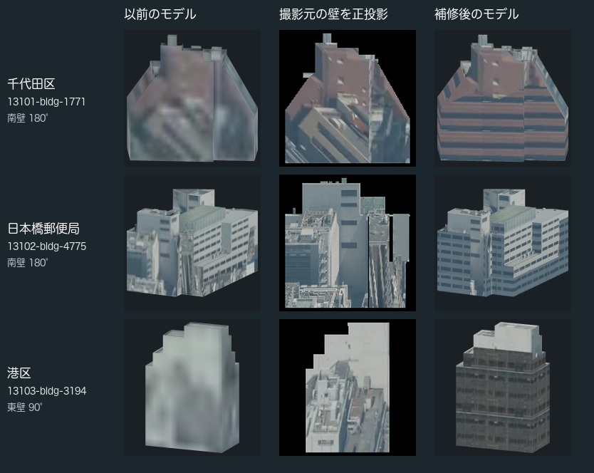
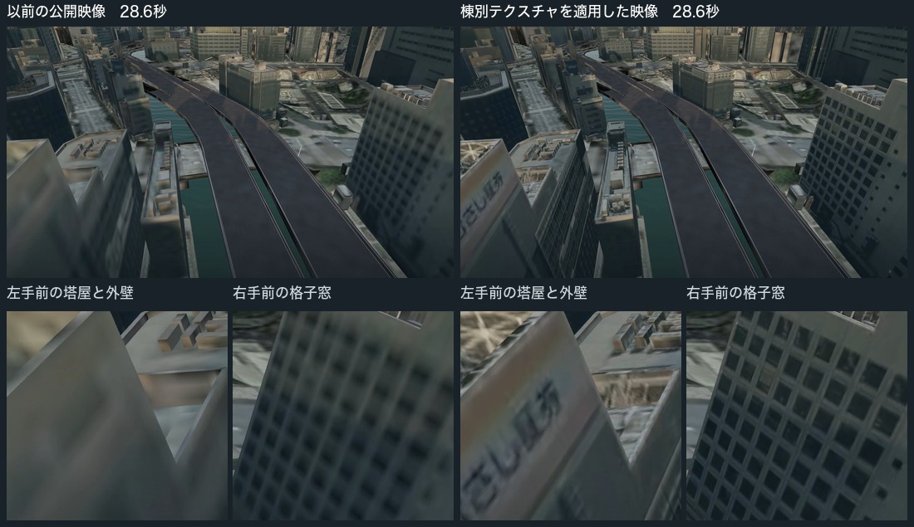

# 建物の外装テクスチャをどう確認したか

元のPLATEAU写真と、Blenderで各棟に割り当てた画像を、同じ棟ID・同じ方位で比べた。撮影画像には、隣の建物の屋上や空調設備が手前の建物の壁一面に投影された例がある。壁に映ったものを補修し、実際に水平な屋上にあるヘリポート、塔屋、下屋、看板やひさしを保存した。[元データと配信タイルの対応](building-textures.md) ・ [棟別画像の制作と出典](../assets/BUILDING-TEXTURES.md)

## 目視と機械検査

- **元画像の全件検査**では23,115棟すべてを、北から45度刻みの8方位と俯瞰の計208,035視点で描画した。壁内の急激な色変化や孤立した緑、同棟屋上との画像の類似を機械で集計した。屋上の形を実際の建物と比較するには、人が複数方位と面の向きを照合する必要がある。
- **高層の目視**では、実際の三角形の最高点と最低点の標高差が60m以上の514棟を抽出し、全棟を8方位と俯瞰、計4,626視点で検収した。建物が傾いたローカル軸の外接箱を使うと高さを過大評価することがあるため、保存モデルの頂点をワールド座標へ移して算出した。駅周辺の近景に加え、各区の優先候補から外れた棟からも、補修すべき側面119棟分を制作へ戻した。
- **低層の機械上位**では、60m未満の22,601棟から各区上位12棟ずつの計36棟を目視した。元写真を壁面に正投影し、20棟で屋上、設備、運動場のラインなどの流入を識別した。
- **機械順位から独立した標本**は3区、実高さ3段階、元写真の被覆別に抽出した92棟。過去に指摘がなかった棟を各層に含めた。高さ60m未満の64棟について、元写真がある48棟全件を8方位と俯瞰、元写真の正投影4面で確認。元写真がない16棟は別に集計した。各区・高さ帯で決まった棟数を取る層化標本なので、表の比率を全市の比率に換算することはできない。[64棟の判定と方位](building-paint-sample.csv) ・ [標本の再抽出](../tools/sample-building-views.py)

| 60m未満の独立標本 | 元写真を確認した棟 | 明確な写真の流入 | 画像が粗い等で保留 | 明確な流入を確認せず | 元写真なし |
| --- | ---: | ---: | ---: | ---: | ---: |
| 千代田区 | 16 | 6 | 2 | 8 | 8 |
| 中央区 | 16 | 9 | 4 | 3 | 8 |
| 港区 | 16 | 6 | 5 | 5 | 0 |
| 合計 | 48 | 21 | 11 | 16 | 16 |

独立標本における確証21棟のうち、元版の低層機械順位上位10%に現れたものは0棟、上位50%でも9棟だった。撮影元の屋上画像を隣の棟が遮った例では、壁と同じ棟の屋上との画像比較が効きにくい。低解像度の回転画像では識別できなかった道路や室外機も、撮影元の画素を壁面に投影した図で確認できた。各棟の色の差だけを根拠に、実際の外壁の影や看板を消すことは避けた。

## 未見の低層を使った再検査

既に調べた棟を除き、元写真のある高さ60m未満から各区12棟を3回抽出した。各回とも抽出したIDと制作側の自動予測を先に固定した。その後、8方位と俯瞰に加え、元の撮影画素を各建物の主要4立面に投影した画像をAstraが判定した。狭い線状構造、影と屋根を分けられない低解像度写真などは保留にした。[108棟のID・実高さ・判定・方位](building-paint-holdouts.csv)

| 写真ありの低層標本 | 棟数 | 混入を確認 | 明確な流入を確認せず | 保留 |
| --- | ---: | ---: | ---: | ---: |
| 第2標本 | 36 | 18 | 9 | 9 |
| 第3標本 | 36 | 21 | 3 | 12 |
| 第4標本 | 36 | 16 | 5 | 15 |

第2標本の固定予測では、確証18棟のうち4棟に対応し、問題の方位まで一致したのは3棟だった。明確な流入を確認しなかった9棟への介入は0件、保留9棟では2件だった。第3標本でも元の低層全件の機械順位上位10%に入ったのは確証21棟中1棟だった。隣の建物による遮蔽を加えた別の固定予測では、この21棟のうち20棟を拾い、方位まで一致したのは18棟だった。明確な流入を確認しなかった3棟のうち1棟、保留12棟のうち3棟にも介入する予測だった。既存の窓割りを保持するため、確証ごとに方位と写真の部位を制作側へ返した。

窓列や斜材の方向を検査するように制作側が修正した後、第4標本を評価した。既に選ばれた棟など405 IDを母集団から除外した。確証16棟中15棟で介入する方位が一致し、明確な流入を確認しなかった5棟への介入は0件、保留15棟では3件だった。標本ごとの誤検出の差には対象建物の違いも含まれる。

補修後の第1回再検査では、210棟の8方位と俯瞰、計1,890視点を目視した。中央区の13102-bldg-6542と港区の13103-bldg-9619に見えた斜めの反復は、同じモデルを縦横4倍の解像度で描き、面積平均で縮小すると水平の窓や桟に戻った。両棟は撮影元にも同じ水平線があることを確認し、材質を維持した。一方、千代田区の13101-bldg-1767で見えた白い斜線は、別方向と壁面写真を照合して隣棟屋根の輪郭と確認し、追加の補修へ回した。

## 実際の空撮で映る建物

8カットの実際のカメラを0.5秒間隔で再現し、160×90画素で建物同士の前後関係を計算した。遠景を含む各タイルでは複数の建物を1枚の縮小画像にまとめ、画面内で大きく映る上位72棟には同じ棟別画像の高解像度版を割り当てた。大きく映る窓や低層の外周で解像度が落ち込みにくくなり、個別ビューでは全棟で元の専用画像の解像度を使える。[カメラ経路の計測](../tools/measure-building-flight.mjs) ・ [Blenderから配信画像・UVへの照合](../tools/audit-building-web.py)

先行データで上位となった低層29棟は、主要4立面の元写真も調べた。日本橋郵便局の南側、三方の壁に屋上設備が写る13102-bldg-6092、塔屋の実在する看板と北壁に被った屋上を区別できる13102-bldg-7371など、13棟を新たに制作側へ戻した。対象面には各棟の裏手も含む。

空撮近景13棟の補修版を8方位と俯瞰（117視点）で見直した。日本橋郵便局の南側は機械の写った屋根が水平窓に替わり、建物本来の屋上の輪郭は残った。13102-bldg-7371と13102-bldg-6684では、側面に焼き付いた別棟の屋根を取り除いた後も、塔屋の看板が読める。

## 目視した棟の範囲

高層全514棟、3区の低層標本、空撮近景、個別補修266棟を通じて、8方位と俯瞰または主要4立面を目視した棟は重複を除いて756棟（うち60m未満242棟）。このほか、一括補修の試験では109棟を各棟の画像変化が大きい1方位で旧版と比較した。この109棟中83棟は先の756棟と重複せず、人が実際に画像を見た範囲の合計は839棟となる。23,115棟すべてに対しては同一条件の8方位・俯瞰の描画と数値検査を行った。

自動補修の比較では、別棟の屋根が写っていると正しく判定した箇所でも、明るい壁に暗い四角が残る失敗があった。周囲の色調に合わせにくい部分は元の写真を残し、判定保留を棟別ビューに表示するようにした。原画像で屋根が壁を覆っていると特定できた6棟は個別補修に切り替えた。中央区の13102-bldg-24では正面の大きな屋上設備が窓列に替わり、港区の13103-bldg-11489では低層部に隣接する外壁と同じ間隔の窓が戻った。

## 確認できる具体例

中央列は縮小前の撮影元写真を壁に正投影したもの。日本橋郵便局の南壁の左側には別棟の白いパラペットと多数の屋上機器が見える。補修後は同じ建物に残る外壁の色調と窓間隔を使って、撮影時に隠れた部分を補った。

| 建物ID | 調べた向きと結果 |
| --- | --- |
| 13101-bldg-1826（星のや東京） | 西壁に投影された緑のヘリポートは、公開されている外装の意匠に合わせて格子を推定制作した。初稿の暗さを再調整し、下地のガラスと階ごとの水平帯が見えることを確認した。 |
| 13101-bldg-2089 | 上空から見えるヘリポートが水平な実際の屋上にあることを照合。西側壁面に写り込んだ別の屋上を補修し、屋上の緑と標識が残ることを再確認した。 |
| 13101-bldg-1643 | 北壁に屋上設備、西壁下部に別棟の広告と屋上が写っていた。東の実際の窓、南の横窓上部を参照した。 |
| 13102-bldg-25 | 南を向く細長い鉛直面に緑のスポーツコートのラインが入り、屋根と壁を共用するUVの検査だけでは拾えなかった。 |
| 13103-bldg-933 | 北の壁中央を大きな矩形の設備屋根が覆う。反対面と本来の屋上の向きを照合した。 |

公開ビューアでは棟IDを入力して、ドラッグ、自動回転、拡大で個々の建物を確認できる。棟ごとに同じ方位で比較したい場合は、回転画像ZIPを展開して索引を開く。[東京駅丸の内駅舎から開く](https://kexi.github.io/astra-5-2-tokyo/?model=city-buildings&id=13101-bldg-1663) ・ [全棟の回転画像](https://github.com/kexi/astra-5-2-tokyo/releases/download/tokyo-station-textures-v2/building-turntables.zip)

## 保存版を使った再検収

上記の初回集計の後、独立標本92棟と当時の個別補修台帳266棟を、保存用のデータから改めて描画した。25棟が重複するため実数は333棟。各棟の8方位と俯瞰を192×192画素、各画素4×4サンプルで描き、2,997視点すべてを目視した。初稿から絵が変わったのは独立標本の35棟と補修台帳の全266棟、重複を除いて276棟。独立標本の残り57棟では、三角形データ・専用画像・回転画像のSHA-256も初稿と一致した。

原寸で側面を比較すると、先の補修範囲の反対側や足元に、窓列を横切る別棟の屋上が残る例があった。最初の通覧で見つけた高層を含め、計16棟を制作に戻した。中央区の13102-bldg-3119と港区の13103-bldg-7676では緑のヘリポートが鉛直面に写っていた。13101-bldg-2425では西面の中央を別棟の屋上設備と外壁が覆っていた。霞が関ビルディング（13101-bldg-1591）では広場に低いひさしが実在するため、塔の上層まで写り込んだ曲線を同じビルの窓間隔で補い、ひさしのある地上部分と区別した。[東南側からの地上写真（2022年、Akonnchiroll撮影）](https://commons.wikimedia.org/wiki/File:Kasumigaseki_Building_2022.jpg)

16棟を三列（元のPLATEAU・直前の保存版・補修後）で照合した。ヘリポート除去後も7676に小さな白い屋上の断片が残ったため、45度の視点で位置を特定し、同じ面の窓に合わせて修正した。さらに1844の角に見える山形の設備、2760の北東面に引き伸ばされた斜線、4507の足元の屋根を、反対側の視点と元の斜壁までたどって再補修した。この3棟は計27視点、16棟全体は計144視点で再確認した。さらに輪郭の細い5棟は各方位384×384画素で再描画し、旧稿と同じ位置を拡大して比較した。霞が関ビルの壁中腹に残った階段状の線、3933の壁に残った曲面屋根の弧、9171の斜めの上縁、2425の西側低層に写り込んだ白い設備、7676の反対側に残った白線まで取り除いた。5657と9100の淡い色むらは原画で特定の屋根との対応を確認できず、その色を残した。

この16棟のうち10棟は既に個別台帳にあり、6棟を新たに登録した。最終の個別補修台帳は272棟。独立標本と個別台帳に含まれない遠景・低層では、元写真が粗く、影・反射・他棟の写り込みを画像だけで判別しきれない箇所が残る。該当棟のビューアには判定保留を表示する。[個別補修の定義](../tools/blender_texture_reviews.py)

## Three.jsと公開映像での確認

Blenderから書き出した410タイル・23,115棟と、公開版の2,846,677三角形の全頂点について、位置・UV・法線・素材の分類を照合した。23,115枚の専用画像は合計7,555,731,608画素。WebPへ圧縮した後も全棟で縦横の解像度は同じで、元PNGとの平均絶対色差が最大の棟でも2.886/255だった。都市全景用に縮小した各棟の画像と、空撮近景72棟の高解像度画像も別々に検査した。[配信監査の実装](../tools/audit-building-web.py)

Webの棟別表示で再補修した16棟の8方位、計128枚を確認した。映像は書き出したH.264を全1,185フレーム復号し、8カットの中央と7箇所の切り替え前後、駅舎・屋上設備・橋などの近景を含む43枚を目視した。第7カットの28.6秒では、以前の公開映像でにじんでいた左手前の塔屋の文字や右手前の格子窓が判読しやすくなった。

